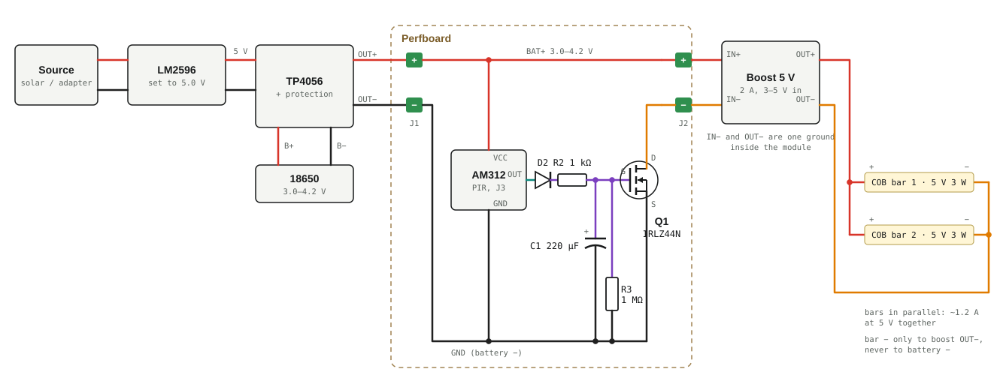
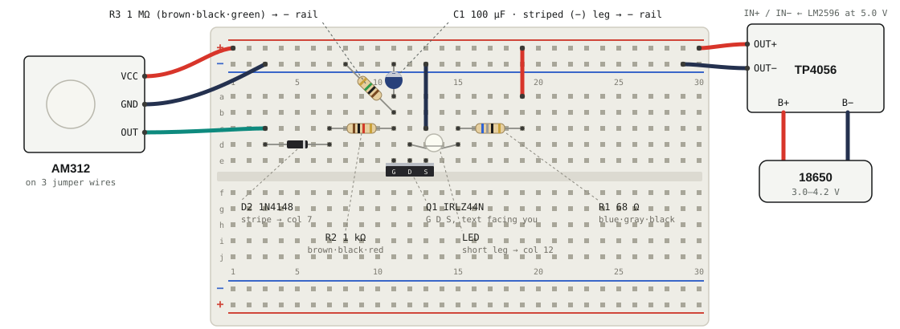

# motion-led-tp4056

A motion-activated LED light that runs off a single 18650 Li-ion cell. The cell
is charged by a TP4056 module, which is fed at 5 V by an LM2596 buck converter.
An AM312 PIR sensor watches for movement. Each time it sees some, it charges a
timing capacitor that holds an IRLZ44N MOSFET on, so the LED stays lit for about
**40 s after the last movement** and then fades out.

With no motion, the whole light circuit draws about **20 µA**, so standby alone
would take years to drain a 2500 mAh cell.

## Schematic



The **OUT−** pad of the TP4056 is the common ground: the PIR's GND, C1, R3 and
Q1's source all go there, **never to B−**. Each motion pulse charges C1 through
D2 and R2. R3 then drains it slowly, keeping Q1 on for about 40 s before the LED
fades out. D2 stops C1 draining back into the sensor when the sensor's output
goes low.

## Breadboard layout



Holes a–e in one numbered column are connected to each other, and so are f–j.
The top red **+** row is the OUT+ rail and the blue **−** row is the OUT− rail.

| Part | Pin / leg | Goes in |
|---|---|---|
| TP4056 | OUT+ / OUT− | + rail · − rail |
| AM312 | VCC · GND · OUT | + rail · − rail · c3 |
| D2 1N4148 | plain end · striped end | d3 · d7 |
| R2 1 kΩ | either leg | c7 ↔ c11 |
| C1 100 µF | long leg (+) · striped leg (−) | a11 · − rail |
| R3 1 MΩ | either leg | b11 ↔ − rail |
| Q1 IRLZ44N | G · D · S (printed side toward you) | e11 · e12 · e13 |
| Jumper | source to ground | c13 → − rail |
| LED | short leg (−) · long leg (+) | d12 · d15 |
| R1 68 Ω | either leg | c15 ↔ c19 |
| Jumper | to supply | a19 → + rail |

For a second LED, put its short leg in any free hole in column 12, its long leg
in a new column, and give it its own 68 Ω resistor to a column jumpered to the
+ rail.

**Check two polarities before powering it.** The IRLZ44N's legs are G-D-S from
left to right when you look at its printed side, with the metal tab facing away
from you. C1's striped leg is negative and goes into the − rail. An
electrolytic capacitor wired backwards can overheat and burst. Also check the
AM312's pin labels on its own board, because the order varies between sellers.

## Parts

| Qty | Part | Value / model | What it does |
|---|---|---|---|
| 1 | PIR sensor | AM312 mini PIR (2.7–12 V) | Detects motion. Its output is 3.3 V while it sees movement. It draws about 15 µA on standby, so it runs straight off the battery. |
| 1 | Q1 MOSFET | IRLZ44N logic-level N-channel (TO-220) | Switches the LED's ground side. Its gate draws almost no current, so it doesn't drain the timing capacitor. |
| 1 | D2 | 1N4148 (or 1N4001–1N4007) | Lets the sensor charge C1 but stops C1 draining back into the sensor. |
| 1 | C1 | 100 µF, 16 V electrolytic | Stores the charge that keeps the light on. |
| 1 | R2 | 1 kΩ, ¼ W | Limits the current that charges C1. |
| 1 | R3 | 1 MΩ, ¼ W | Drains C1 slowly, which sets the on-time. It also keeps the LED off at power-up. |
| N | D1 | White LED, 5 mm or 10 mm, V<sub>f</sub> ≈ 3.0–3.2 V, 20 mA | The light. |
| N | R1 | 68 Ω, ¼ W, one per LED | Limits each LED's current. |
| — | Charging side | LM2596 buck module, TP4056 module **with protection** (6 pads), 18650 cell | Already part of the build. |
| — | Wiring | Half-size breadboard, jumper wires (3 female-to-male for the AM312), then perfboard | Prototype, then solder. |

Optional extras:
- An SPDT slide switch in series with OUT+, as a master off switch.
- A 1 MΩ trimmer in series with 100 kΩ, in place of R3, to set the on-time
  anywhere from about 7 s to 75 s.

## Values

**R1 (LED current).** The cell runs from 3.0 to 4.2 V and a white LED drops
about 3.1 V, so the resistor has very little voltage to work with.

```
R1 = (4.2 − 3.1 − 0.1) / 0.015 ≈ 68 Ω
Full battery (4.2 V) → ≈ 15 mA per LED
Half battery (3.7 V) → ≈  7 mA per LED (dimmer)
```

The LEDs dim as the battery drains. That's expected with a plain resistor.
Anything from 47 Ω to 100 Ω works:

| R1 | Full battery (4.2 V) | Mid battery (3.7 V) |
|---|---|---|
| 47 Ω | ~21 mA | ~11 mA |
| 56 Ω | ~18 mA | ~9 mA |
| **68 Ω** | **~15 mA** | **~7 mA** |
| 82 Ω | ~12 mA | ~6 mA |
| 100 Ω | ~10 mA | ~5 mA |

Don't go below 47 Ω. Constant-current parts (current-regulating diodes,
NSI45020-type drivers) won't work here, because they need 1.8–3 V of headroom
and this circuit only has 0.5–1 V.

**On-time (C1 × R3).**

```
R3 × C1 = 1 MΩ × 100 µF = 100 s
Full brightness ≈ 0.4 × 100 s ≈ 40 s
Fully off       ≈ 0.7 × 100 s ≈ 70 s (fades)
```

| C1 | R3 | Full brightness | Fully off |
|---|---|---|---|
| 100 µF | 470 kΩ | ~20 s | ~30 s |
| **100 µF** | **1 MΩ** | **~40 s** | **~70 s** |
| 220 µF | 1 MΩ | ~1.5 min | ~2.5 min |

These times are approximate. Each MOSFET switches at a slightly different gate
voltage (1–2 V for the IRLZ44N), and electrolytic capacitors vary by ±20%, so
tune R3 for your parts. New motion restarts the timer.

**Battery.** Standby is about 15 µA (PIR) + 3 µA (TP4056 protection chip). With
3 LEDs lit (~45 mA), a 2500 mAh cell gives about 55 h of light.

## Choosing D2

The diode has to block C1's charge with almost no leakage, because R3 drains
only about 3 µA.

| Diode | Use it? | Why |
|---|---|---|
| 1N4148 / 1N914 | Best | Almost no leakage at 3 V. |
| 1N4001 to 1N4007 | Good | Same behaviour, physically bigger. |
| BAT43, BAT46, BAT85 | OK | Small Schottky diodes, low leakage at room temperature. |
| 1N5817, 1N5818, 1N5819 | Only with R3 ≤ 470 kΩ | Power Schottky leakage (µA, and more when warm) drains C1 and shortens the on-time. |
| An LED used as a diode | No | It drops 1.8 V or more, so C1 charges to only about 1.5 V, too low to turn Q1 on. |
| Zener below 5.1 V | No | It conducts backwards at this voltage. |

You can't skip D2. Without it, C1 drains back into the sensor as soon as the
sensor's output goes low, and the light goes back to turning off after about 2 s.

## Build and test

1. With the LM2596 **not connected** to the TP4056, power it and turn its
   trimmer until a multimeter reads **5.0 V** at OUT.
2. Wire LM2596 OUT to TP4056 IN and the cell to B+ / B−. The charger's red LED
   should light while it charges.
3. Build the light circuit with the battery disconnected. Check the MOSFET's pin
   order and the capacitor's polarity.
4. Connect the light circuit to OUT+ / OUT−. Wait **about 60 s** for the PIR to
   settle, because it can trigger on its own during warm-up.
5. Wave a hand in front of it. The LED should stay at full brightness for about
   40 s after the movement stops, then fade out.

## Before you connect it

- **Load ground goes to OUT−, not B−.** The protection chip switches OUT−, so
  wiring to B− skips over-discharge protection and can drain the cell below 2.5 V.
- **Set the LM2596 before connecting it.** These modules come with the trimmer at
  a random setting, and above 8 V the TP4056 is destroyed.
- **Your source must supply 1 A or more.** The TP4056 charges at 1 A by default
  (R<sub>PROG</sub> = 1.2 kΩ).
- **The LM2596 can't power the LEDs from the battery.** It only steps voltage down.
  For a 5 V or 12 V LED strip, add a boost module such as the MT3608 after OUT+.
- **For a knob-set 5 s–5 min timer instead,** use an HC-SR501 powered at 5 V
  through an MT3608 boost module. The boost module draws 1–2 mA all the time,
  which cuts standby from years to about 2 months per charge.

## Revision history

| Rev | Change | Why |
|---|---|---|
| 1 | AM312 + 2N2222 NPN switch, R1 56 Ω, R2 1 kΩ, R3 100 kΩ | First design. Light stayed on about 2 s after motion (the AM312's fixed hold time). |
| 2 | R1 56 Ω → **68 Ω** | Matches the resistor on hand. LED current drops from ~18 mA to ~15 mA on a full battery. |
| 3 | Added the breadboard layout | Hole-by-hole placement for prototyping. |
| 4 | 2N2222 → **IRLZ44N**; added **C1 100 µF** and **D2**; R3 100 kΩ → **1 MΩ** | Capacitor timer extends the on-time to ~40 s. A MOSFET gate doesn't drain the capacitor the way a transistor base would. Parts moved to new holes. |
| 5 | D2 1N5819 → **1N4148** | Power Schottky leakage is comparable to R3's 3 µA drain and would shorten the on-time. |
